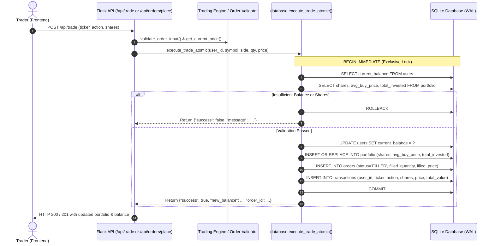
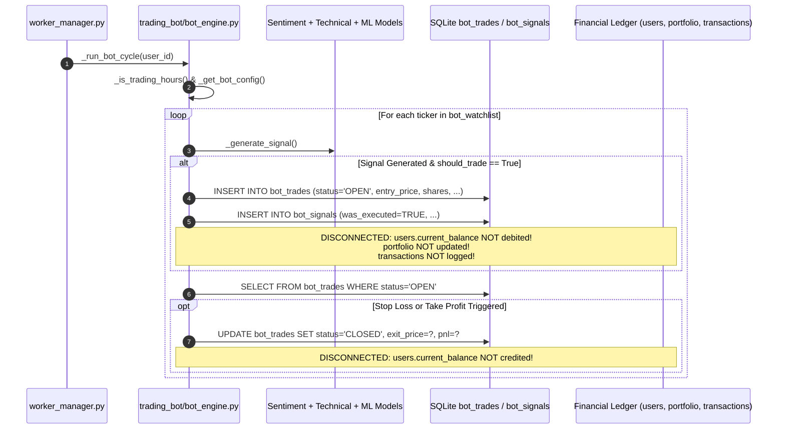

# PHASE C: FINANCIAL LEDGER INTEGRITY AUDIT REPORT

**Project:** Sovereign Intelligence — AI Stock Market Intelligence Dashboard  
**Status:** Audit Completed (Read-Only Investigation & Invariant Verification)  
**Safety Status:** No production code modified. No live trading enabled. Active database protected.

---

## 1. Executive Summary

This audit evaluated the financial accounting consistency across manual paper trades, autonomous bot trades, user cash balances, portfolio holdings, average purchase prices, realized/unrealized P&L calculations, and dashboard summaries.

### Key Conclusions:
1. **The initial audit hypothesis is CONFIRMED and VERIFIED:** Autonomous bot trades are completely disconnected from the financial ledger. When the trading bot executes a BUY, **$0.00 is deducted** from `users.current_balance`, zero holdings are recorded in `portfolio`, and no entries are created in `transactions` or `orders`.
2. **Bot API Endpoints Point to Wrong Tables:** `/api/bot/trades` queries manual user transactions (`transactions` table) instead of `bot_trades`. Similarly, `/api/bot/performance` calculates metrics from manual transactions using FIFO rather than evaluating actual bot trades.
3. **Severe Dictionary Key Mismatch in Positions API:** In `src/app.py` (`/api/positions`), holdings dictionary lookup queries `avg_price` and `quantity`, but the database `portfolio` table stores `avg_buy_price` and `shares`. As a result, the endpoint evaluates all positions to `quantity = 0.0` and `pnl = $0.00`.
4. **Accounting Method Conflict (WAC vs. FIFO):** Manual trade execution in `database.execute_trade_atomic` implements **Weighted-Average Cost (WAC)** for active portfolio holdings, while `database.get_closed_trades()` computes realized P&L using **FIFO (First-In, First-Out)** lot matching, producing mathematical discrepancies between realized and unrealized P&L.
5. **Portfolio Performance Metric Flaw:** `analytics_engine.calculate_portfolio_performance` computes `total_invested` as the cumulative sum of all historical BUY transactions without subtracting sold lots, causing fully closed profitable positions to display catastrophic negative P&L (-100%).

---

## 2. Trade Lifecycles & Data Flows

### A. Manual Trade Lifecycle


#### Manual Trade Data Flow Details:
- **BUY Action:**
  - `total_value = round(quantity * execution_price, 4)`
  - `users.current_balance = round(current_balance - total_value, 4)`
  - `portfolio.shares = existing_shares + quantity`
  - `portfolio.total_invested = existing_total_invested + total_value`
  - `portfolio.avg_buy_price = round(new_total_invested / new_shares, 4)` (Weighted Average Cost)
  - `orders`: Inserted with `status='FILLED'`, `filled_quantity=quantity`, `filled_price=execution_price`
  - `transactions`: Inserted with action `'BUY'`, `shares`, `price_per_share`, `total_value`
- **SELL Action:**
  - `total_value = round(quantity * execution_price, 4)`
  - `users.current_balance = round(current_balance + total_value, 4)`
  - `portfolio.shares = existing_shares - quantity`
  - `portfolio.total_invested = max(0.0, existing_total_invested - (quantity * avg_buy_price))`
  - If `new_shares <= 0.000001`, holding is deleted from `portfolio`
  - `orders`: Inserted with `status='FILLED'`
  - `transactions`: Inserted with action `'SELL'` (Note: Realized P&L is **not** stored in `transactions`)

---

### B. Autonomous Bot Trade Lifecycle


#### Bot Trade Data Flow Details:
- **BUY Execution (`_execute_bot_trade`):**
  - Inserts record into `bot_trades` (`user_id`, `ticker`, `action='BUY'`, `shares`, `entry_price`, `stop_loss`, `take_profit`, `status='OPEN'`, `entry_time`).
  - Inserts record into `bot_signals` (`was_executed=TRUE`).
  - **Does NOT check available user cash.**
  - **Does NOT deduct cash from `users.current_balance`.**
  - **Does NOT create or update holdings in `portfolio`.**
  - **Does NOT log transactions or orders.**
- **Position Exit (`_close_bot_position`):**
  - Computes `pnl = (exit_price - entry_price) * shares`
  - Updates `bot_trades` (`status='CLOSED'`, `exit_price`, `pnl`, `pnl_pct`, `exit_time`, `exit_reason`)
  - **Does NOT credit cash proceeds or P&L back to `users.current_balance`.**

---

## 3. Database Schema Mapping Across Subsystems

| Table Name | Managed By | Purpose in System | Updates `current_balance`? | Reflected in Portfolio? |
| :--- | :--- | :--- | :---: | :---: |
| `users` | Auth & Trading Engine | Stores `starting_balance`, `current_balance` | Yes (Manual Only) | N/A |
| `portfolio` | Trading Engine (`execute_trade_atomic`) | Active user holdings (`ticker`, `shares`, `avg_buy_price`, `total_invested`) | N/A | Yes |
| `orders` | Trading Engine & Broker Endpoints | Advanced order tracking (`OPEN`, `FILLED`, `CANCELLED`) | No (Indirect) | No (Indirect) |
| `transactions` | Trading Engine (`execute_trade_atomic`) | Immutable audit ledger of completed trades | No (Indirect) | No (Indirect) |
| `bot_configs` | Bot Engine & Bot Settings API | User risk parameters (`max_position_size`, `risk_level`, `stop_loss_pct`) | No | No |
| `bot_watchlist` | Bot Engine & Watchlist API | Tickers monitored by autonomous engine | No | No |
| `bot_trades` | Bot Engine (`bot_engine.py`) | Independent shadow log of bot positions | **NO** | **NO** |
| `bot_signals` | Bot Engine (`bot_engine.py`) | AI confidence scores and trading signals | No | No |

---

## 4. Evaluation of the 11 Accounting Invariants

| Invariant | Description | Manual Trades | Bot Trades | Audit Verdict |
| :--- | :--- | :---: | :---: | :--- |
| **1** | A buy reduces available cash by the correct transaction amount. | **PASS** (`new_balance = current_balance - total_value`) | **FAIL** (Cash never deducted) | **PARTIAL** |
| **2** | A sell increases available cash by the correct proceeds. | **PASS** (`new_balance = current_balance + total_value`) | **FAIL** (Proceeds never credited) | **PARTIAL** |
| **3** | Holdings change correctly after buys and sells. | **PASS** in DB / **FAIL** in `/api/positions` API response | **FAIL** (Holdings never recorded) | **FAIL** |
| **4** | Average purchase price remains consistent with implemented accounting method. | **PASS** (Implements Weighted-Average Cost in `portfolio`) | **N/A** (Independent trade records) | **DISCREPANCY** (Holdings uses WAC, but Analytics uses FIFO) |
| **5** | Realized P&L is calculated correctly. | **FAIL** (Not recorded in DB; `analytics_engine` formula is flawed) | **PARTIAL** (Calculated in `bot_trades`, but never credited to cash) | **FAIL** |
| **6** | Unrealized P&L uses appropriate current or explicitly identified cached market price. | **PARTIAL** (Uses yfinance live, but falls back to 0.0 on error resulting in -100% P&L) | **PASS** (Calculated against live market price) | **PARTIAL** |
| **7** | Fees, if supported, are included consistently. | **N/A** (`commission=0.00` in DB; 0.1% hardcoded in unused `paper_exchange.py`) | **N/A** (No fees tracked in `bot_trades`) | **DISCREPANCY** |
| **8** | Trade records, balances, and holdings remain consistent after a transaction. | **PASS** (Atomic transaction with `BEGIN IMMEDIATE` and rollback) | **FAIL** (Shadow table only; balance/holdings untouched) | **PARTIAL** |
| **9** | Failed transactions do not leave partial accounting updates. | **PASS** (Strict rollback on failure) | **PASS** (Bot trade insert fails atomically if DB errors) | **PASS** |
| **10** | Duplicate transaction processing cannot silently double-count a trade. | **PASS** on `/api/orders/place` / **FAIL** on `/api/trade` | **PASS** (`_has_reached_daily_limit` throttle) | **PARTIAL** |
| **11** | Bot trades and manual trades follow compatible accounting rules. | Incompatible shadow universe | Incompatible shadow universe | **FAIL** |

---

## 5. Detailed Findings & Severity Breakdown

### Finding 1: Autonomous Bot Trades Completely Bypass the Financial Ledger
- **Severity:** **CRITICAL**
- **Location:** [src/trading_bot/bot_engine.py](file:///c:/Users/Atul/project/stock-main/src/trading_bot/bot_engine.py#L351-L394) (`_execute_bot_trade` and `_close_bot_position`)
- **Reproduction:**
  1. Trigger `bot_engine._execute_bot_trade(user_id, signal, config)` with a BUY of 5 shares of MSFT @ $300 ($1,500 total).
  2. Inspect `users.current_balance` and `portfolio`.
- **Expected Behavior:** User's cash balance decreases by $1,500.00, and 5 shares of MSFT appear in the user's portfolio.
- **Actual Behavior:** Cash balance remains identical ($0.00 difference). Portfolio remains empty. A row is added only to `bot_trades`.
- **Financial Impact:** Users can run autonomous trading bots with zero cash balance, exceeding risk limits infinitely without ledger accounting.
- **Remediation:** Connect `TradingBotEngine` to `database.execute_trade_atomic` or establish a designated bot sub-ledger account with pre-allocated capital.

---

### Finding 2: Bot API Endpoints Return Manual Trades Instead of Bot Trades
- **Severity:** **HIGH**
- **Location:** [src/app.py](file:///c:/Users/Atul/project/stock-main/src/app.py#L640-L689)
- **Code:**
  ```python
  @app.route('/api/bot/trades', methods=['GET'])
  def get_bot_trades():
      user_id = int(get_jwt_identity())
      trades = database.get_transactions_by_user(user_id, limit=100) # BUG: Returns manual trades!
      return jsonify({'trades': trades}), 200

  @app.route('/api/bot/performance', methods=['GET'])
  def get_bot_performance():
      user_id = int(get_jwt_identity())
      trades = database.get_closed_trades(user_id) # BUG: Evaluates manual trades!
  ```
- **Reproduction:**
  Call `GET /api/bot/trades` and `GET /api/bot/performance`.
- **Expected Behavior:** Returns records from `bot_trades` table (`database.get_bot_trades(user_id)` and `database.get_closed_bot_trades(user_id)`).
- **Actual Behavior:** Returns records from `transactions` table (manual paper trades). If the user made manual trades, those trades appear as "bot trades".
- **Financial Impact:** Erroneous reporting. Users cannot evaluate bot profitability or track bot performance accurately.

---

### Finding 3: Dictionary Key Mismatch in `/api/positions` Renders All Holdings as 0
- **Severity:** **HIGH**
- **Location:** [src/app.py](file:///c:/Users/Atul/project/stock-main/src/app.py#L1508-L1528) (`get_positions()`)
- **Code:**
  ```python
  for item in portfolio:
      symbol = item.get('ticker', item.get('symbol', ''))
      avg_price = float(item.get('avg_price', 0) or 0)     # DB column is 'avg_buy_price'
      quantity = float(item.get('quantity', 0) or 0)       # DB column is 'shares'
      ...
      pnl = (ltp - avg_price) * quantity                   # Evaluates to (ltp - 0) * 0 = 0.0
      current_value = round(ltp * quantity, 2)             # Evaluates to 0.0
  ```
- **Reproduction:**
  1. Execute a paper trade buying 10 shares of AAPL.
  2. Call `GET /api/positions`.
- **Expected Behavior:** Returns `[{"symbol": "AAPL", "quantity": 10.0, "avg_price": 150.0, "current_value": 1500.0, ...}]`.
- **Actual Behavior:** Returns `[{"symbol": "AAPL", "quantity": 0.0, "avg_price": 0.0, "current_value": 0.0, "pnl": 0.0}]`.
- **Financial Impact:** The positions table in the frontend terminal displays zero holdings and zero P&L despite active database holdings.

---

### Finding 4: Accounting Method Inconsistency (Weighted Average Cost vs. FIFO)
- **Severity:** **HIGH**
- **Location:** [src/database.py](file:///c:/Users/Atul/project/stock-main/src/database.py#L1062-L1100) vs [src/database.py](file:///c:/Users/Atul/project/stock-main/src/database.py#L1769-L1803)
- **Details:**
  - `execute_trade_atomic` calculates and maintains `portfolio.avg_buy_price` using **Weighted-Average Cost (WAC)**:
    `new_avg_price = (existing_total_invested + new_total) / (existing_shares + new_shares)`.
  - On partial sell, cost basis is deducted using weighted-average price:
    `new_total_invested = existing_total_invested - (quantity * avg_buy_price)`.
  - However, `get_closed_trades()` (used for performance analytics and win-rate calculation) processes transactions using **FIFO lot matching**.
- **Empirical Demonstration:**
  - Buy 10 @ $150 ($1,500), Buy 10 @ $200 ($2,000). Total: 20 shares @ WAC $175.
  - Sell 10 @ $220 ($2,200 proceeds).
  - WAC Realized P&L: 10 * ($220 - $175) = **$450.00**. (Remaining in portfolio: 10 shares @ $175 = $1,750 cost basis).
  - FIFO Realized P&L calculated by `get_closed_trades`: 10 * ($220 - $150) = **$700.00**.
  - **Discrepancy:** **$250.00** discrepancy between what the ledger deducted from portfolio cost basis vs what performance analytics reports as realized profit.

---

### Finding 5: Cumulative Buy Sum Flaw in `analytics_engine.py`
- **Severity:** **HIGH**
- **Location:** [src/analytics_engine.py](file:///c:/Users/Atul/project/stock-main/src/analytics_engine.py#L34-L39)
- **Code:**
  ```python
  total_invested = sum([t['total_value'] for t in transactions if t['action'] == 'BUY'])
  total_pnl = total_value - total_invested
  total_pnl_pct = (total_pnl / total_invested * 100) if total_invested > 0 else 0
  ```
- **Reproduction:**
  1. Buy $100,000 of AAPL.
  2. Sell $100,000 of AAPL at $105,000 ($5,000 profit).
  3. Holding value is now $0.00.
  4. `analytics_engine` calculates: `total_value` = 0, `total_invested` = 100,000, `total_pnl` = 0 - 100,000 = **-$100,000.00 (-100%)**.
- **Financial Impact:** Active traders who close positions see massive negative portfolio returns instead of positive profits.

---

### Finding 6: Limit Orders Do Not Hold Escrow Buying Power & Disconnected `fill_order()`
- **Severity:** **MEDIUM**
- **Location:** [src/app.py](file:///c:/Users/Atul/project/stock-main/src/app.py#L1451-L1473) and [src/database.py](file:///c:/Users/Atul/project/stock-main/src/database.py#L1700-L1708)
- **Details:**
  - When placing a limit order, `app.py` checks `if user_balance < total_required:`, but **does not lock or escrow the balance**.
  - A user with $1,000 can place ten $900 limit orders simultaneously.
  - Furthermore, `database.fill_order()` only updates `orders SET status = 'FILLED'`. It does not debit cash, update portfolio holdings, or create transaction records.

---

### Finding 7: Lack of Duplicate Order Guard on `/api/trade`
- **Severity:** **LOW - MEDIUM**
- **Location:** [src/app.py](file:///c:/Users/Atul/project/stock-main/src/app.py#L713-L735)
- **Details:**
  `/api/orders/place` employs `duplicate_detector.is_duplicate()`, but the legacy `/api/trade` route does not. Rapid double-clicks on the trade button will execute two distinct orders and debit balance twice.

---

## 6. Empirical Verification Test Results

Tests were performed against an isolated temporary SQLite database created via `tempfile.mkdtemp()`.

```text
Isolated DB initialized at: ...\sovereign_ledger_audit_8p8ft1lt\test_ledger_audit.db
User created: ID=1, Starting Balance=$100,000.00

--- Test Invariant 1 & 4: BUY Trades ---
Buy 10 AAPL @ $150: Success=True, New Balance=$98,500.00
Portfolio after Buy 1: 10.0 shares, avg_buy_price=$150.00, total_invested=$1,500.00
Buy 10 AAPL @ $200: Success=True, New Balance=$96,500.00
Portfolio after Buy 2: 20.0 shares, avg_buy_price=$175.00, total_invested=$3,500.00
WAC Avg Price: Expected=$175.00, Actual=$175.00 (VERIFIED)

--- Test Invariant 2 & 5: SELL Trades & Realized P&L ---
Sell 10 AAPL @ $220: Success=True, New Balance=$98,700.00
Portfolio after Sell: 10.0 shares, avg_buy_price=$175.00, total_invested=$1,750.00
Closed Trades (get_closed_trades): FIFO Realized PnL: $700.00
WAC Realized PnL: $450.00
Discrepancy: $250.00 (VERIFIED CONFLICT)

--- Test Invariant 3: Portfolio API Key Mappings (/api/positions) ---
Database portfolio row keys: ['id', 'user_id', 'ticker', 'shares', 'avg_buy_price', 'total_invested', 'created_at', 'updated_at']
/api/positions parser results:
  symbol: 'AAPL'
  avg_price: 0.0 (BUG: evaluates to 0.0 because key is 'avg_buy_price')
  quantity: 0.0 (BUG: evaluates to 0.0 because key is 'shares') (VERIFIED BUG)

--- Test Invariant 11: Bot Trades vs Balance & Ledger ---
Executing BUY for MSFT (5 shares @ $300 = $1,500)
Bot trade executed: BUY MSFT
Cash balance before bot BUY: $98,700.00
Cash balance after bot BUY:  $98,700.00 (Actual diff = $0.00) (VERIFIED DISCONNECT)
Holdings after bot BUY: ['AAPL'] (MSFT NOT added to portfolio)
bot_trades record count: 1
```

---

## 7. Recommended Remediation Plan (Phase D Proposal)

1. **Option A (Unified Ledger - Recommended):**
   - Route `TradingBotEngine._execute_bot_trade()` through `database.execute_trade_atomic()`.
   - Add an `is_bot INTEGER DEFAULT 0` column to `orders` and `transactions` tables.
   - Bot trades directly debit/credit `users.current_balance` and update `portfolio`.
   - Update `/api/bot/trades` and `/api/bot/performance` to filter by `is_bot = 1`.

2. **Option B (Partitioned Bot Sub-Account):**
   - If bot funds must remain separate from manual trading, create a `bot_allocated_balance` column in `bot_configs`.
   - Bot trades debit and credit the allocated sub-balance, preventing runaway risk against the main user balance.

3. **Positions Key Normalization:**
   - In `src/app.py` (`/api/positions`), normalize row access to:
     `avg_price = float(item.get('avg_buy_price', item.get('avg_price', 0)) or 0)`
     `quantity = float(item.get('shares', item.get('quantity', 0)) or 0)`

4. **Accounting Method Harmonization:**
   - Unify closed-trade accounting with active holdings by storing `realized_pnl` directly on `transactions` during SELL execution in `execute_trade_atomic()`.
   - Update `analytics_engine.py` to use `total_invested` from active holdings (`sum(h['total_invested'] for h in portfolio)`) and sum `realized_pnl` from closed transactions.

---

## 8. Unresolved Questions for User Alignment

Before implementing fixes in subsequent phases, please confirm preferences on:
1. **Bot Capital Architecture:** Should autonomous bot trades share the main user cash balance directly (Unified Ledger), or should each bot have a dedicated risk-allocated budget (Partitioned Ledger)?
2. **Accounting Method:** Should the system standardize on **Weighted-Average Cost (WAC)** (standard for retail brokerages) across both active holdings and closed trade history, or should both use **FIFO**?
3. **Short Selling:** `bot_engine._close_bot_position` contains short-sell P&L logic, but `execute_trade_atomic` disallows selling shares not owned (`existing_shares < quantity`). Should short selling / margin be formally supported or explicitly restricted?

---

## 9. Review and Git Status
- `git status --short`:
  ```text
   M README.md
   M tests/test_phase1_security.py
   M tests/test_phase4_integration.py
  ?? PHASE_A_SETUP_REPORT.md
  ?? PHASE_B_TEST_ISOLATION_REPORT.md
  ?? PHASE_C_FINANCIAL_LEDGER_AUDIT.md
  ?? empty
  ?? requirements.txt
  ?? tests/conftest.py
  ```
- `git diff --check`: Passed with zero errors.
- **Safety Rule Confirmation:** No changes were made to trading engines, application code, frontend UI, or Git history. Active database `data/stock_dashboard.db` was not modified.
